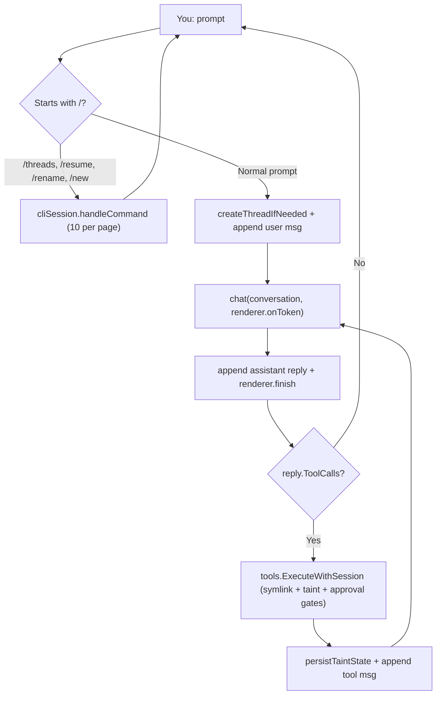

# Enma Harness architecture

Enma Harness is a small Go CLI agent. You type a prompt, it streams a response from an OpenAI-compatible model server, runs local file tools when the model asks for them, and saves the conversation to disk.

If you are reading this codebase for the first time, start with the high-level loop below, then read each layer from the smallest building block (`config`) up to the CLI loop (`main`).

## 1. Central configuration (`config/config.go`)

Every package imports `config` instead of hardcoding its own URLs, prompts, or limits. Changing the model, `ChatCompletionsURL`, `MaxContextTokens`, `ReadFileMaxLines`, `ThreadsPerPage`, `ShowThinkingTraces`, or `InMemoryOnly` happens in one file.

Security path lists live here too: `AlwaysSensitive` (`.git`, `.vscode`, `.zed`, `.mcp.json`, `.enma`) and `TaintedSensitive` (`AGENTS.md`).

## 2. Local tools and security gates (`tools/`)

The model cannot touch your disk directly. Instead, it asks the harness to run one of four registered tools (`tools.All`):

- `read_file` reads UTF-8 line slices capped by `ReadFileMaxLines` and `ReadFileMaxBytes`.
- `list_files` paginates directory entries capped by `ListFilesMaxEntries`, marking folders with `/`.
- `edit_file` replaces one exact substring in an existing file using `atomicWriteFile` (temp file, `Sync`, `Chmod`, `Rename`).
- `write_file` creates new UTF-8 files and missing parent folders, refusing to overwrite unless `overwrite: true` is passed.

Every tool call goes through `ExecuteWithSession`. Before running a tool, `resolveRealPath` walks up to the nearest existing parent folder and runs `filepath.EvalSymlinks` so a symlink inside the repo cannot hide a target outside it. Then `requiredApproval` checks two rules in Go code:

1. Writes to `~/.enma` or `AlwaysSensitive` repo paths always ask `[y/N]`, even in a clean session.
2. External data can carry hidden instructions (indirect prompt injection). Once a session reads or lists inside `untrusted/`, `Session.Tainted` flips to `true`, `read_file` wraps every returned slice in `<untrusted_data>` tags, and any later read/write outside `ProjectRoot` or write to `TaintedSensitive` asks `[y/N]` with a warning.

## 3. Thread storage (`threads/`)

When `InMemoryOnly` is false, `threads.Store` saves each conversation under `~/.enma/threads/<YYYYMMDD-HHMMSS-hex>/`:

- `meta.json` holds `id`, `name`, `project_root`, `model`, `tainted`, and timestamps, written atomically.
- `messages.jsonl` appends one JSON `Message` per line as each message happens. On load, a truncated trailing line from a crash is ignored instead of breaking the whole thread.

Separating `meta.json` from `messages.jsonl` lets `/rename` and taint updates happen without rewriting message history. Resuming a thread restores `Session.Tainted` from `meta.json`.

## 4. Model streaming, display, and context (`chat.go`, `display.go`, `context.go`)

- `chat.go` posts `[]Message` and `tools.Specs()` to `ChatCompletionsURL` with `stream: true`. It separates `delta.reasoning`, `delta.reasoning_content`, and `<think>...</think>` blocks from answer text, assembles chunked `tool_calls` by index, and falls back to byte-based token estimates when the server omits `usage`.
- `display.go` renders streamed tokens with `colors.go`. When `ShowThinkingTraces` is false, it runs a rhombus spinner (`◇ ◈ ◆ ◈`) on TTY stdout and clears the line when the answer begins or errors; `reply.Reasoning` is still captured and saved to `messages.jsonl`.
- `context.go` computes prompt, completion, tool, and reasoning token counts against `MaxContextTokens` and prints the context badge after each reply.

## 5. The CLI loop (`main.go`, `commands.go`)

`main.go` wires `threads.Store`, `tools.Session`, and `cliSession`, then loops at the `You:` prompt. No thread folder is created on disk until you send a real prompt, so slash-only sessions (`/threads`, `/resume`, `/rename`, `/new`) leave nothing behind.
