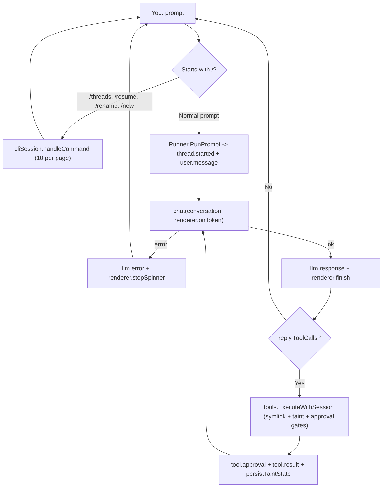

# Enma Harness architecture

Enma Harness is a small Go CLI agent. You type a prompt, it streams a response from an OpenAI-compatible model server, runs local file tools when the model asks for them, and saves the conversation to disk.

If you are new to this repo, start with the turn loop below, then follow each layer from `config` up to `main`.

## 1. Central configuration (`config/config.go`)

Every package reads its URLs, prompts, and limits from `config`. Changing the model, `ChatCompletionsURL`, `MaxContextTokens`, `ReadFileMaxLines`, `ThreadsPerPage`, `ShowThinkingTraces`, or `InMemoryOnly` happens in one file.

The path lists for security checks live here too: `AlwaysSensitive` (`.git`, `.vscode`, `.zed`, `.mcp.json`, `.enma`) and `TaintedSensitive` (`AGENTS.md`).

## 2. Local tools and security gates (`tools/`)

The model can't touch your disk on its own. It asks the harness to run one of four tools registered in `tools.All`:

- `read_file` reads UTF-8 line slices capped by `ReadFileMaxLines` and `ReadFileMaxBytes`.
- `list_files` paginates directory entries capped by `ListFilesMaxEntries`, marking folders with `/`.
- `edit_file` replaces one exact substring in an existing file via `atomicWriteFile` (temp file, `Sync`, `Chmod`, `Rename`).
- `write_file` creates new UTF-8 files and missing parent folders. It refuses to overwrite an existing file unless `overwrite: true` is passed.

Why doesn't the CLI call `Run` directly? Because a model can ask to edit `.git/hooks` or follow hidden instructions inside an untrusted file. Every tool call goes through `ExecuteWithSession` instead.

Before a tool runs, `resolveRealPath` walks up to the nearest existing parent folder and runs `filepath.EvalSymlinks`. That stops a symlink inside the repo from hiding a real target outside it. Then `requiredApproval` enforces two rules in Go code:

1. Writes to `~/.enma` or `AlwaysSensitive` repo paths always ask `[y/N]`, even in a clean session.
2. Reading or listing inside `untrusted/` flips `Session.Tainted` to `true`, and `read_file` wraps every returned slice in `<untrusted_data>` tags so partial line reads can't strip the boundary. Once tainted, any read or write outside `ProjectRoot` and any write to `TaintedSensitive` asks `[y/N]` with a warning.

## 3. Thread storage (`threads/`)

When `InMemoryOnly` is false, `threads.Store` saves each conversation under `~/.enma/threads/<YYYYMMDD-HHMMSS-hex>/`:

- `meta.json` holds `id`, `name`, `project_root`, `model`, `tainted`, and timestamps, written atomically.
- `events.jsonl` appends one JSON `Event` per line (`thread.started`, `user.message`, `llm.response`, `llm.error`, `tool.approval`, `tool.result`) with zero duplicate message snapshots. On load, a truncated trailing line from a crash is ignored instead of breaking the whole thread, and `foldEvents` reconstructs `[]Message` and `Tainted` for `/resume`.

Keeping `meta.json` separate from `events.jsonl` lets `/rename` and taint updates happen without rewriting event history. Resuming a thread restores both `conversation` and `Session.Tainted`.

## 4. Streaming, display, and context (`chat.go`, `display.go`, `context.go`)

`chat.go` posts `[]Message` and `tools.Specs()` to `ChatCompletionsURL` with `stream: true`. It routes `delta.reasoning`, `delta.reasoning_content`, and `<think>...</think>` blocks into `onToken(token, isThinking)`, assembles chunked `tool_calls` by index, and falls back to byte-based token estimates when the server omits `usage`.

`display.go` renders streamed tokens with `colors.go`. When `ShowThinkingTraces` is false, it runs a rhombus spinner (`◇ ◈ ◆ ◈`) on TTY stdout and clears the line when the answer starts or errors. The harness still captures `reply.Reasoning` and saves it to `messages.jsonl`.

`context.go` counts prompt, completion, tool, and reasoning tokens against `MaxContextTokens` and prints the context badge after each reply.

## 5. Runner and CLI loop (`runner.go`, `main.go`, `commands.go`)

`runner.go` decouples the prompt-model-tool loop (`Runner.RunPrompt`) from terminal I/O so it can run both interactively and headless. `main.go` wires `threads.Store`, `tools.Session`, `Runner`, and `cliSession`, then loops at the `You:` prompt. No thread folder is created on disk until you send a real prompt, so slash-only sessions (`/threads`, `/resume`, `/rename`, `/new`) leave nothing behind.
